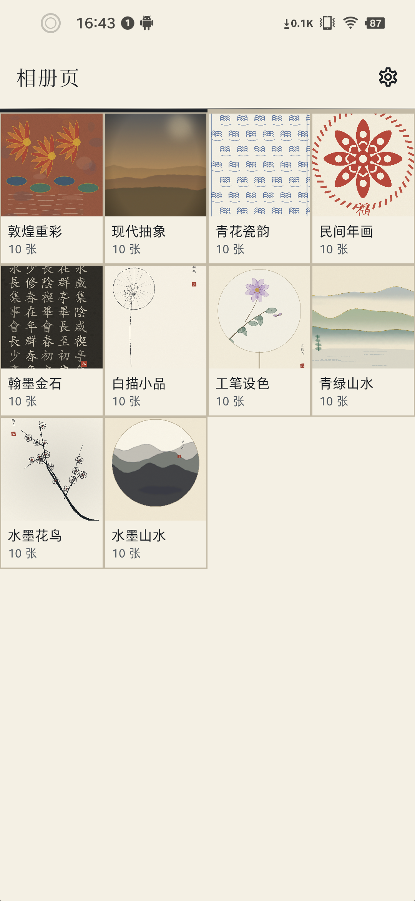
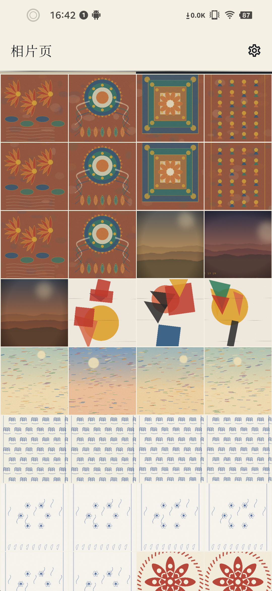
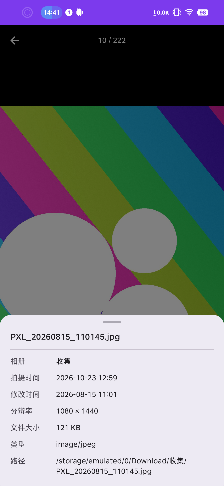
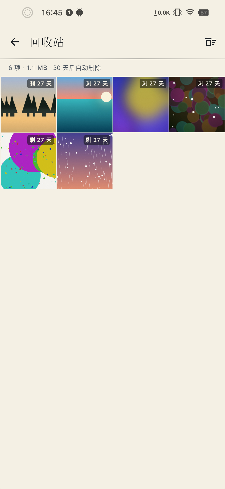

# 弄墨相册（ink-gallery）

Android 本地相册应用，Kotlin + Jetpack Compose，纯本地 MediaStore 读取，不联网。

## 📥 下载安装（APK）

**👉 [点击这里进入 Release 页面下载 APK](https://gitee.com/qiantu/ink-gallery/releases)**

> 手机浏览器打开码云仓库首页不显示 Release 入口，请直接使用上面这个链接，选择最新版本的 `.apk` 附件下载安装即可（安装前需允许「安装未知来源应用」）。

## 截图

| 相册页 | 相片页 |
| :---: | :---: |
|  |  |
| 按文件夹聚合，封面 / 名称 / 数量 | 全部照片视频，4 列平铺，长按多选 |

| 相片详情 | 相片信息 |
| :---: | :---: |
|  |  |
| 全屏查看，双击缩放、左右翻页 | 上滑查看文件名 / 时间 / 分辨率 / 路径 |

| 回收站 |
| :---: |
|  |
| 删除的照片保留 30 天，可恢复或彻底删除 |

## 功能

- 首页两个页面，左右滑动切换：**相册页**（按文件夹分组）、**相片页**（全部照片，4 列平铺）。
- 标题栏标题跟随页面切换，右侧为设置入口；标题栏下方为 4dp 滑动指示条。
- 相册页点击分组进入该相册的照片列表（4 列平铺）。
- 相片页长按进入多选，支持按住拖动连选，可批量移动相册、删除到回收站。
- 任意照片点击进入全屏查看：双击缩放、左右翻页；上滑查看详情；支持编辑、分享、移动、删除。
- 回收站：删除的照片与视频保留 30 天，可恢复、彻底删除或一键清空。
- 设置页：所有文件访问权限入口、回收站、关于。

## 技术栈

Kotlin 2.0.21 / AGP 8.5.2 / Gradle 8.10.2 / Compose BOM 2024.12.01 / Material3 / Hilt 2.56 /
Navigation 2.7 / Coil 2.7（图片加载）/ Room 2.7.1（回收站元数据）。

照片与视频全部从 MediaStore 读取，元数据一次加载进内存，由 ContentObserver 监听媒体库变化；
进程启动时用磁盘快照抢首帧，后台再与 MediaStore 核对。不联网、不上传。

## 目录

```
app/src/main/java/com/ink/gallery/
├── data/        MediaStore 查询、回收站仓库、Room 数据库、磁盘快照
├── di/          Hilt 模块
├── feature/     home / buckets / bucketdetail / photos / viewer / trash / settings
├── navigation/  路由
├── ui/          theme + 通用组件（网格、多选手势、缩略图）
└── util/        权限、格式化
```

## 构建

```
.\gradlew.bat assembleRelease
```

或直接执行 `build_apk.ps1`，APK 会复制到桌面并重命名为 `ink-gallery-<版本名>-<版本号>.apk`。

签名信息从根目录 `local.properties` 读取（`signing.storeFile` / `signing.storePassword` /
`signing.keyAlias` / `signing.keyPassword`），缺失时产出未签名包。
